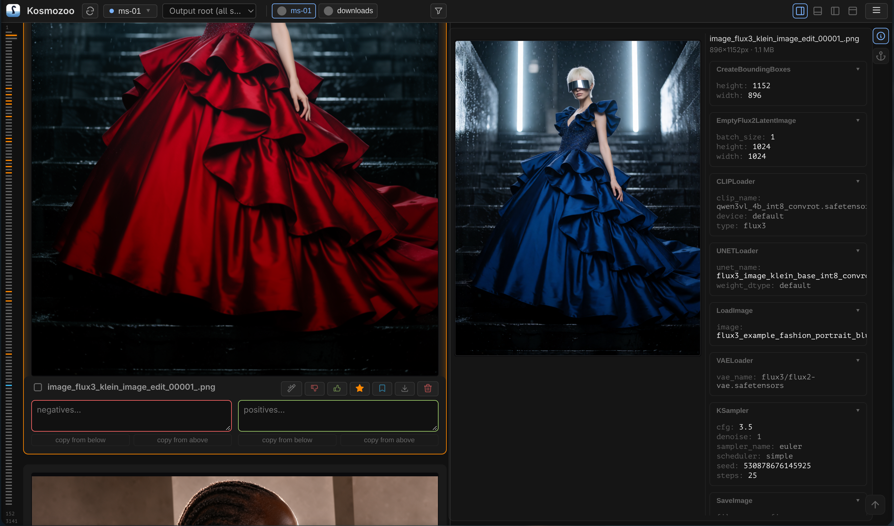
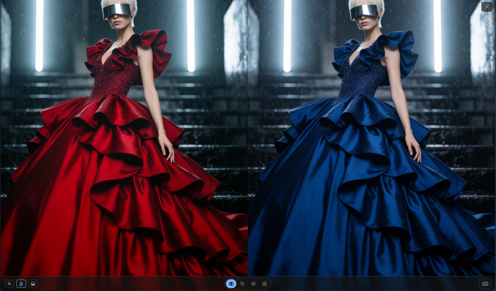
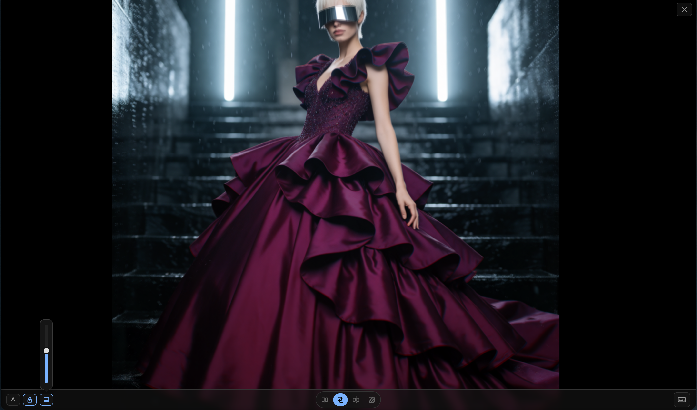
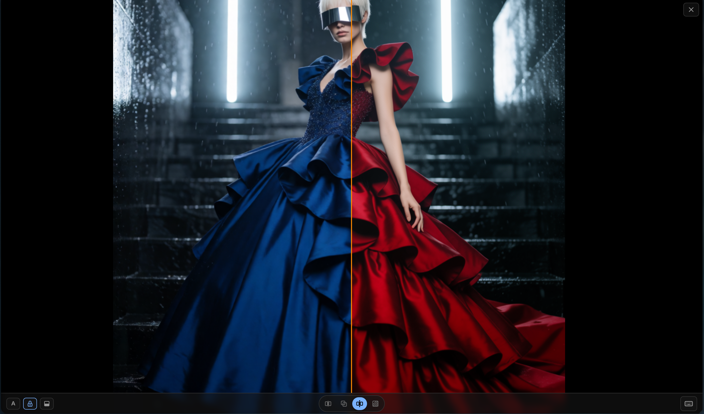
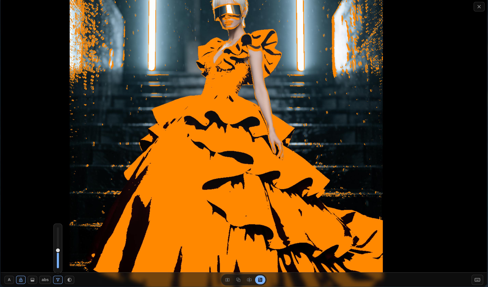

# Kosmozoo

Efficiently compare a high volume of generated images against preset
anchors, and capture detailed feedback on what is wrong or right with each
one.

This tree is the Deno engine + Solid client implementation. The engine runs
unbundled as native ESM; the Solid client compiles via
`build.mjs` into `client-solid-dist/` — with the engine exposed as a public
API and downstream curation (buckets, captions, reject-sets) moved behind a
plugin boundary.

- **Product rationale:** `~/Documents/kosmozoo/NORTH_STAR.md`
- **Engine + client contract:** `docs/spec.md`
- **The outgoing Python implementation** is tagged `python-final`.

Packaged runs include the [Linux x86_64 executable](docs/executable.md), with
installed-browser app windows and an optional user-local installer, and the
[production container image](docs/container.md), with built UI, cached engine
dependencies, native SQLite and persistent state/cache. Desktop mode defaults
to loopback2084; service/source/Docker mode to0.0.0.0:2084, with explicit
`KOZMOZOO_BIND`/`KOZMOZOO_PORT` overrides. The devcontainer is for contributing.

## Install

- Download the Linux x86_64 executable from the [GitHub releases](https://github.com/alexindigo/kosmozoo/releases).
- Use the container image `ghcr.io/alexindigo/kosmozoo`.
- On Arch, install an AUR package: `kosmozoo` (source, runs on Arch's `deno`),
  `kosmozoo-bin` (official executable, with package files generated by `package-resources`), or `kosmozoo-git` (latest source).

## Features

- The executable includes the client, opens in an installed browser, and offers
  optional user-local installation. Releases include the executable and checksum;
  [source links and licensing](packaging/linux/LICENSING.md) are documented, and
  package and user installs preserve data.
- Browse recursive source folders in a newest-first feed, with live source
  activity and updates delivered through an event stream.
- Edit Variations and submit runs while keeping control of unsaved work.
- Keep your place while images arrive: dimensions are resolved before rendering,
  and cards keep fixed, whole-pixel heights as the feed fills.
- Save votes, favorites, notes and independent return-later bookmarks per image.
- Keyboard shortcuts respect modal layers; engine settings and browser-local
  browsing/layout preferences preserve your setup between visits.

## Screenshots

Browse the image feed with feedback controls, a reference image and generation metadata alongside it.

Compare two images side by side in the full-screen workbench.

Blend the compared images with an adjustable overlay opacity.

Inspect the images across a vertical split in the comparison workbench.

Highlight image differences in orange with the threshold control visible.

## Status

The Deno rewrite is functional: engine, feed, comparison workbench, and the
plugin/feature tiers are live. `docs/spec.md` is the binding contract;
`PLUGINS.md` covers the plugin surface.

## Contributing

Open the repository in its devcontainer and install the hook once per clone:
`git config core.hooksPath dev/hooks`.
The hook runs `deno task deps` against the staged tree inside the devcontainer
image, then runs frozen, cached-only unit tests and the client build, using its
resource caps and Docker or Podman (Podman is preferred when available).

For manual work in the devcontainer, acquire modules with `deno task deps`, then
build with `deno run --frozen --cached-only --allow-all build.mjs` and run
`deno task test` (which prepares dependencies before cached-only tests).
`deno task setup` also requires the prepared cache. Only `deps` acquires modules;
`deno task deps:update` deliberately updates the lock for review. Dependencies
come from npm/jsr, never HTTP module imports. Regenerate the checked-in browser
assets with `deno task vendor` after acquisition.

The browser suite (`tests/e2e/run.sh`) prepares one run-owned dependency cache,
then starts both engines and fakes with `--frozen --cached-only`. Set
`E2E_DENO_DIR` to an absolute disk-backed directory to reuse a caller-owned cache;
the runner prepares it through the same task and preserves it at cleanup.
