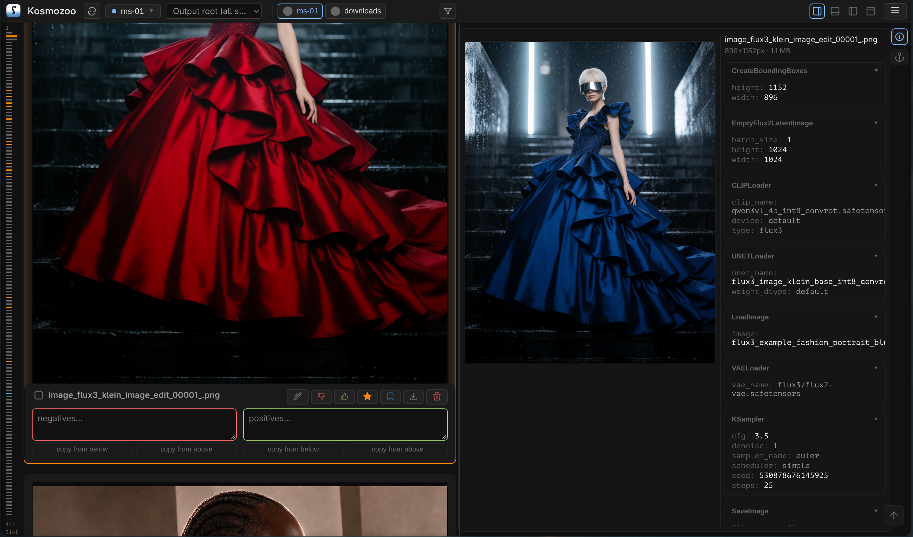
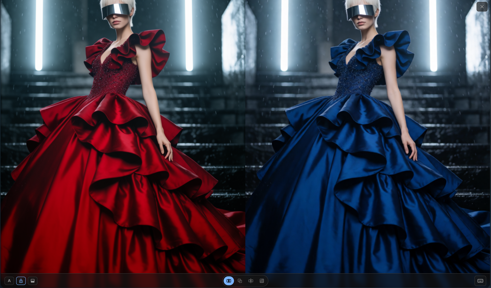
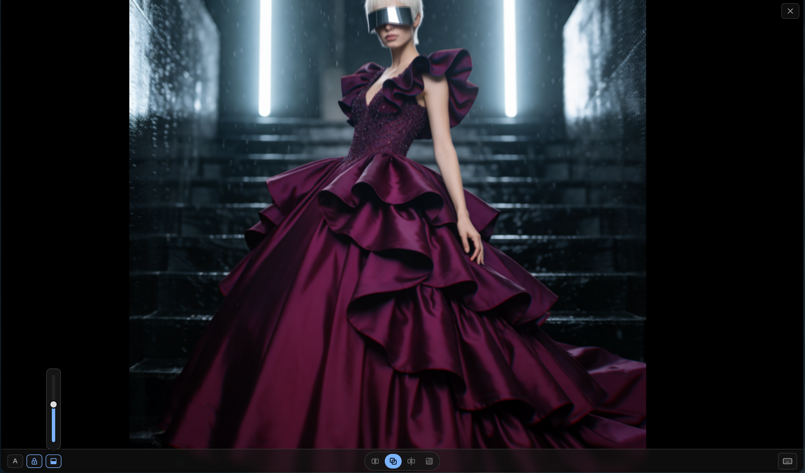
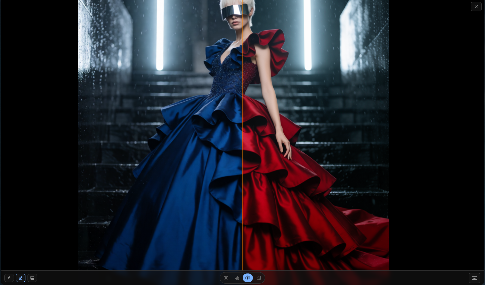
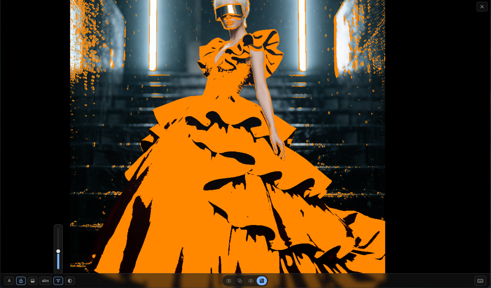
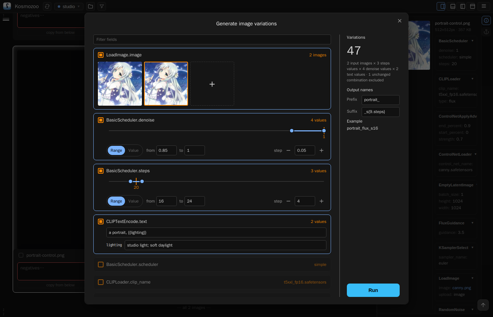
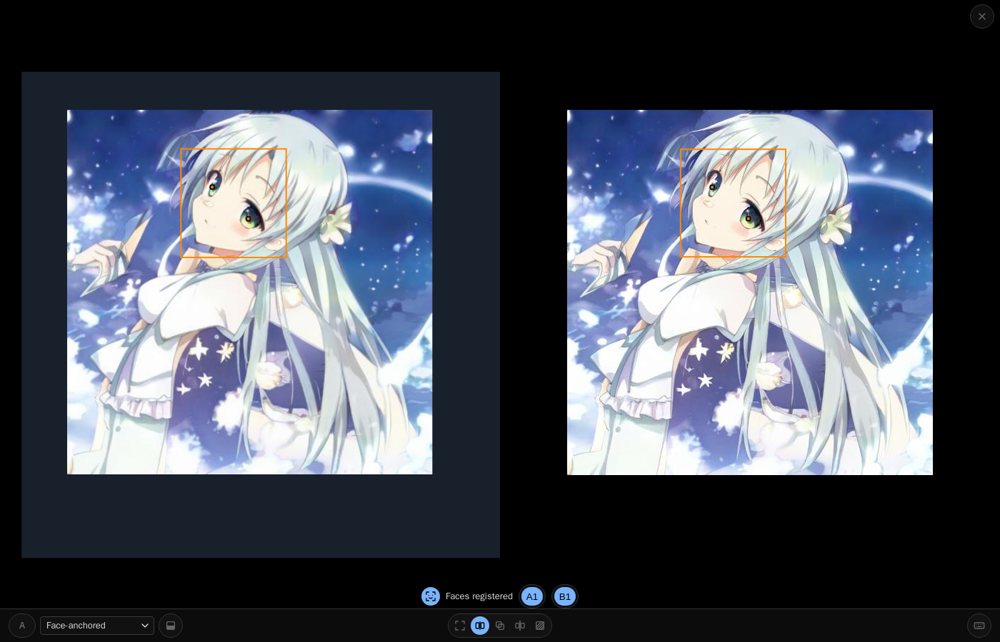

# Kosmozoo

Compare large batches of ComfyUI output against reference images, spot subtle
differences, and record what is right or wrong with each result. Browse new
arrivals as they finish, review images, video and audio, and send promising
workflows back to ComfyUI as controlled parameter variations.

Kosmozoo runs as a Linux desktop app or a self-hosted browser UI. A Deno engine
serves the Solid client and a [public API](docs/spec.md#2-engine-api-public).

## Install

| # | Installation | Details |
|---|---|---|
| 1 | [Linux x86_64 executable](docs/executable.md) | Download from [GitHub releases](https://github.com/alexindigo/kosmozoo/releases); opens an installed browser in app mode where supported, with an optional user-local installer. |
| 2 | [Docker](docs/container.md) | `ghcr.io/alexindigo/kosmozoo` includes the built UI and engine; mount persistent state and cache. |
| 3 | Arch Linux AUR | [`kosmozoo`](https://aur.archlinux.org/packages/kosmozoo) builds a release from source, [`kosmozoo-bin`](https://aur.archlinux.org/packages/kosmozoo-bin) uses the official executable, and [`kosmozoo-git`](https://aur.archlinux.org/packages/kosmozoo-git) tracks current source. |

Desktop mode defaults to `127.0.0.1:2084`; service, source and Docker mode
default to `0.0.0.0:2084`. Override with `KOZMOZOO_BIND` and `KOZMOZOO_PORT`.
See the installation guides for launch, storage and upgrade details, and
[licensing](packaging/linux/LICENSING.md) for dependency and source links.

## Features

### Browse sources and follow generation

| # | Capability | What you can do |
|---|---|---|
| 1 | ComfyUI and local folders | Add multiple ComfyUI hosts or folders on the engine computer. Browse nested ComfyUI output folders when the source supports recursive discovery; local folder sources list the selected directory's files. |
| 2 | Live source activity | Pin sources, see queue counts, current-operation progress and approximate workflow progress when available, and notice unseen arrivals on other sources. Enable automatic refresh per source or refresh manually. |
| 3 | Stable, newest-first feed | Browse large collections in a virtualized feed that keeps your place as new items arrive. Background acquisition can be enabled or paused independently of browsing. |
| 4 | Navigation rail | Click or scrub to an image, wheel through the rail, and hover for an image or video-frame preview. Tick colors reflect judgments; new arrivals briefly light their ticks. |
| 5 | Metadata and lineage | Inspect embedded prompts, generation parameters, node inputs and source-image lineage beside the feed. Resize panes and choose the details or reference workspace and its layout. |

### Compare against references

| # | Capability | What you can do |
|---|---|---|
| 1 | Reference images | Drop local images into the anchor pane, reorder them, or compare against images discovered in workflow metadata. |
| 2 | Comparison compositions | Open the clicked item in Full view; use Two-Up side by side, One-Up overlay/blink, a draggable Split wipe, or Difference for still-image pairs. Switch candidate/reference while keeping the comparison view. |
| 3 | Pan, zoom and alignment | Inspect details with pan and zoom, including Ctrl+wheel and pinch gestures. Choose Independent views or Shared movement; viewer crops remain separate from saved feed/reference crops. |
| 4 | Opacity and Difference | Adjust opacity in eligible comparison views. Difference highlights pixel changes with a threshold and separate base/highlight opacity controls. |
| 5 | Shareable context | Comparison URLs identify both sides; feed URLs retain the source, image, folder and filters, with Back/Forward navigation. |

### Optional face detection and alignment

| # | Capability | What you can do |
|---|---|---|
| 1 | Opt-in detection | Turn detection on for an eligible still-image pair. It starts OFF on each page load and requires an external detector service; the model and Python runtime are not bundled. |
| 2 | Face choices | All detected faces start selected. Choose an alignment face explicitly when an image has multiple faces; choosing an anchor keeps the other faces selected. A single usable face can anchor directly. |
| 3 | Face-anchored comparison | Match the selected faces' eye midpoint and scale, then pan/zoom with a common camera. Detection can also show boxes with Independent or Shared alignment. This is geometric alignment, without rotation or identity recognition. |

Follow the [detector installation and run guide](docs/face-detection.md) to install
the Python service and download its models. In the Web UI, open Settings/Options
-> **Face detector service**, enter the engine-reachable URL and **Save**. For a
native Linux engine on the detector computer, use `http://127.0.0.1:8471`; the
engine resolves this URL, not the browser. Open a still-image pair in a comparison
view, turn **Face detection** on, then select **Face-anchored** and choose face
anchors as needed. The URL persists; detection starts OFF on each page load.
Selecting Face-anchored does not enable detection. Turning detection off hides
its feedback and alignment effect while retaining choices for the current page
session. The [custom API and 28-landmark compatibility requirements](docs/face-detection.md#api-compatibility)
explain when another detector library needs an adapter.

### Record feedback and find results

| # | Capability | What you can do |
|---|---|---|
| 1 | Detailed feedback | Save up/down votes, favorites, separate return-later bookmarks, and positive/negative notes with autosave. Down-votes hide by default; that preference is configurable. |
| 2 | Combined filters | Combine filename, directory, vote/favorite/bookmark, feedback text and generation-parameter conditions with AND or OR. Filters live in the URL and do not erase judgments. |
| 3 | Individual and bulk actions | Select multiple items for feedback, Variations, downloads or removal. Copy source-relative names, optionally prefix copied/downloaded names with the source, and export each source's judgments as `feedback.json`. |
| 4 | Source-aware removal | Removal uses recoverable ComfyUI trash when available/configured, otherwise hides output and cleans history; local-folder deletion permanently unlinks the file. |

### Generate Variations

Variations edits the embedded ComfyUI workflow for one result or a captured
selection, then queues the requested combinations on the originating source.

| # | Capability | What you can do |
|---|---|---|
| 1 | Parameter controls | Filter fields by name, enable independent node/input controls, choose numeric ranges or single values with a step, and select enum alternatives. Bulk numeric ranges are offsets from each target's current value. |
| 2 | Text templates | Preserve multiline prompt text and expand explicit `{{label}}` substitutions using semicolon-separated alternatives. Newlines remain content, not extra variants. |
| 3 | Ordered image sets | Mix ComfyUI inputs from source tabs, browser files, dragged images and recursive folders on the engine computer. Reorder/remove tiles, search thumbnails, or use each target's Current image as its own input. |
| 4 | Counts and names | Preview the combination count, contributing axes, unchanged-combination exclusion and a representative output name. Prefix/suffix fields accept parameter tokens; long source stems fold to fit the filename budget. |
| 5 | Protected drafts | Each opening starts fresh. Closing with unsent edits asks before discarding; successful runs show confirmation and close, while partial or failed runs keep the draft and result available without automatic resubmission. |

### Video, audio and everyday controls

| # | Capability | What you can do |
|---|---|---|
| 1 | Media review | Play MP4, WebM and MOV video, and FLAC, MP3, Opus and WAV audio in the feed and viewer. Playback is manual with seek, mute and optional per-player looping; starting a player pauses the others. |
| 2 | Media workflows | Read embedded generation metadata and lineage and open Variations for supported embedded ComfyUI workflows, including video and audio. |
| 3 | Playback limits | Codec support follows the browser. Video comparisons have independent players, without synchronized playback or Difference; audio uses a single Full view. Failed formats remain downloadable. |
| 4 | Keyboard controls | Open Actions & keys with `?`, inspect current bindings and rebind them. Space toggles focused playback; shortcuts respect text fields, native controls and modal layers. |
| 5 | Remembered setup | Engine settings and judgments persist across visits. Browser-local preferences retain pane/layout choices, anchors and each source's browsing position; feed/reference crops and key bindings are saved. |

### API and extensions

| # | Capability | Details |
|---|---|---|
| 1 | Public engine API | Use the documented [collection, content, judgment, settings and feature routes](docs/spec.md#2-engine-api-public) from other clients or tools. The browser UI is one client of that engine. |
| 2 | Drop-in plugins | Add trusted local engine plugins with namespaced routes, settings and fields. See [PLUGINS.md](PLUGINS.md) for discovery and the injected API. |

Add ComfyUI sources as `host[:port]` (HTTP only, no URL scheme), or local sources
as `folder:/path`. The default HTTP port is 80: `comfy.home` is stored and shown
as `comfy.home:80`; explicit ports must be whole numbers from 1 through 65535.
The optional first-boot `KOZMOZOO_HOSTS` seed uses the same grammar, for example
`studio=comfy.home,worker=worker.home:8188`.

## Screenshots

### Feed and comparison workbench

Browse the image feed with feedback controls, a reference image and generation metadata alongside it.

Compare two images side by side in the full-screen workbench.

Blend the compared images with an adjustable overlay opacity.

Inspect the images across a vertical split in the comparison workbench.

Highlight image differences in orange with the threshold control visible.

### Variations editor

Build an image set and vary ranges and template values together. The count
explains the combinations and excludes the unchanged tuple; naming and Run
remain alongside the fields. This demonstration uses workflow/media fixtures.

### Face detection and registration

The translated/scaled demo candidate on the left is registered to the reference
on the right using the detected eyes. Detection is ON here, with A1 and B1 as
anchors. It is optional, externally configured and OFF by default.

## Documentation

| # | Guide | Covers |
|---|---|---|
| 1 | [Executable](docs/executable.md) | Desktop launch, user-local installation, service mode and state. |
| 2 | [Container](docs/container.md) | Container image, persistent volumes and runtime configuration. |
| 3 | [Face detector](docs/face-detection.md) | Python/model installation, foreground launch, Web UI connection and API compatibility. |
| 4 | [Specification](docs/spec.md) | Shipped behavior, public API, storage and feature contracts. |
| 5 | [Plugins](PLUGINS.md) | Trusted drop-in engine extensions. |
| 6 | [Changelog](CHANGELOG.md) | Release-by-release changes. |

## Contributing

Open the repository in its devcontainer and install the hook once per clone:
`git config core.hooksPath dev/hooks`.
The hook runs `deno task deps` against the staged tree inside the devcontainer
image, then runs frozen, cached-only unit tests and the client build, using its
resource caps and Docker or Podman (Podman is preferred when available).

For manual work in the devcontainer, acquire modules with `deno task deps`, then
build with `deno run --frozen --cached-only --allow-all build.mjs` and run
`deno task test` (which prepares dependencies before cached-only tests).
`deno task setup` also requires the prepared cache. Only `deps` acquires modules;
`deno task deps:update` deliberately updates the lock for review. Dependencies
come from npm/jsr, never HTTP module imports. Regenerate the checked-in browser
assets with `deno task vendor` after acquisition.

The browser suite (`tests/e2e/run.sh`) prepares one run-owned dependency cache,
then starts both engines and fakes with `--frozen --cached-only`. Set
`E2E_DENO_DIR` to an absolute disk-backed directory to reuse a caller-owned cache;
the runner prepares it through the same task and preserves it at cleanup.
