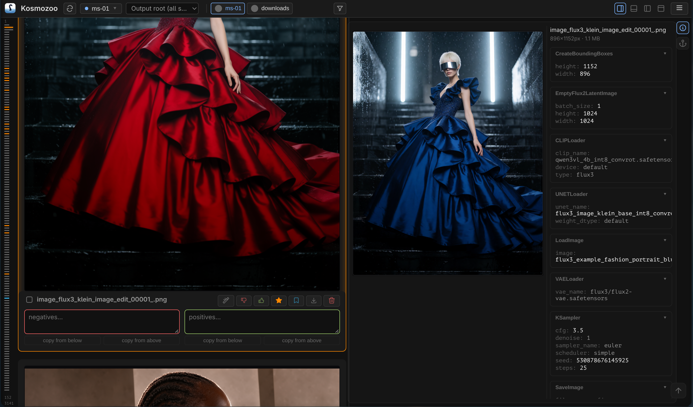
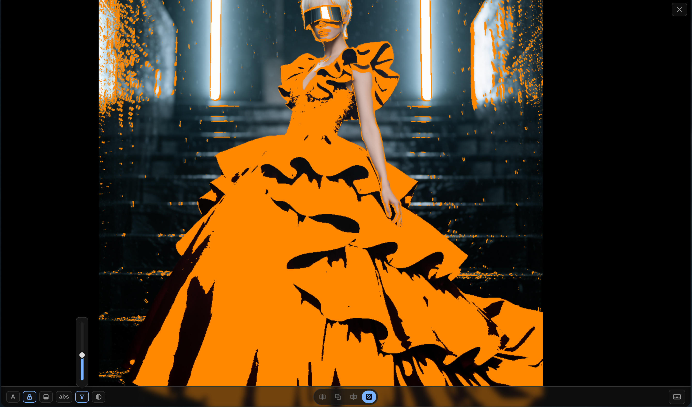
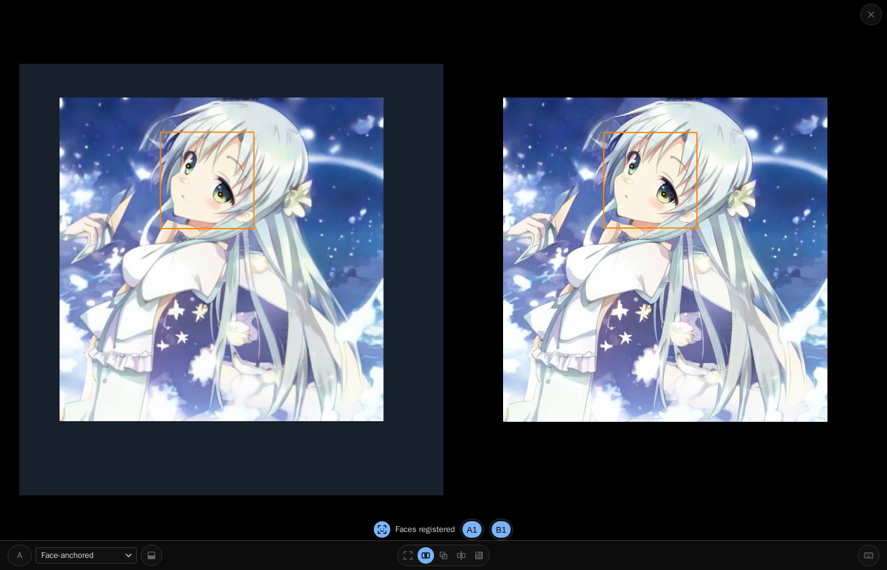
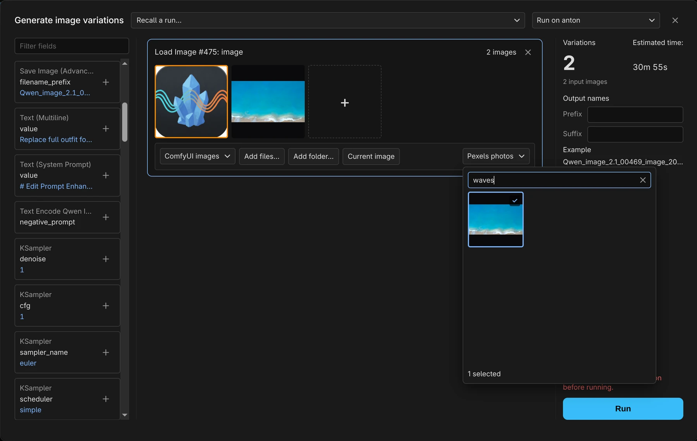

# Kosmozoo

Review ComfyUI output at volume. Compare each result against reference images,
spot the small differences, and record what is right or wrong with it. When a
result is close, re-run its workflow with controlled changes on any of your
ComfyUI machines.

Kosmozoo runs as a Linux desktop app or a self-hosted browser UI.

## Features

### Follow your output

- Watch new results arrive from several ComfyUI machines or local folders, with queue and progress status.
- Images, video and audio, with embedded prompts, parameters and source-image lineage beside the feed.
- Unseen results are marked, so nothing slips past.

### Compare against references

- Side by side, blink, split wipe and pixel difference, with shared pan and zoom.
- Optional face-anchored alignment for character work (needs the separate [face detector](docs/face-detection.md)).

### Record your judgment

- Votes, favorites, bookmarks and positive/negative notes on every result.
- Filter by feedback, filename or generation parameters; act on many results at once.

### Re-run as variations

- Turn any result's embedded workflow into a batch: parameter ranges, prompt templates, alternative models and input images (ComfyUI inputs, local files and folders, or Pexels photos).
- Run on any of your ComfyUI machines; anything the target lacks is flagged before a job is sent.
- Every run is saved and can be recalled.

### Open engine

- The browser UI is one client of a documented [engine API](docs/spec.md#2-engine-api-public); add engine [plugins](PLUGINS.md).

## Install

- **Linux executable**: download from [releases](https://github.com/alexindigo/kosmozoo/releases), see the [guide](docs/executable.md).
- **Docker**: `ghcr.io/alexindigo/kosmozoo`, see the [container guide](docs/container.md).
- **Arch Linux (AUR)**: [`kosmozoo`](https://aur.archlinux.org/packages/kosmozoo), [`kosmozoo-bin`](https://aur.archlinux.org/packages/kosmozoo-bin) or [`kosmozoo-git`](https://aur.archlinux.org/packages/kosmozoo-git).

It listens on port 2084 (`KOZMOZOO_PORT`, `KOZMOZOO_BIND`). Add sources in the
app as `host[:port]` for a ComfyUI server or `folder:/path` for a local folder.

## Documentation

[Executable](docs/executable.md), [container](docs/container.md),
[face detector](docs/face-detection.md), [specification and API](docs/spec.md),
[plugins](PLUGINS.md), [changelog](CHANGELOG.md) and
[licensing](packaging/linux/LICENSING.md).

## Contributing

See [CONTRIBUTING.md](CONTRIBUTING.md) for the devcontainer, the pre-commit hook
and the test suites.
